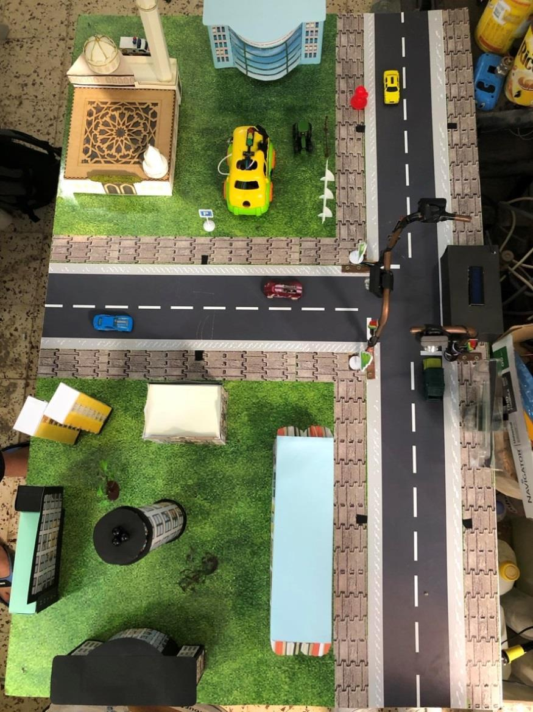
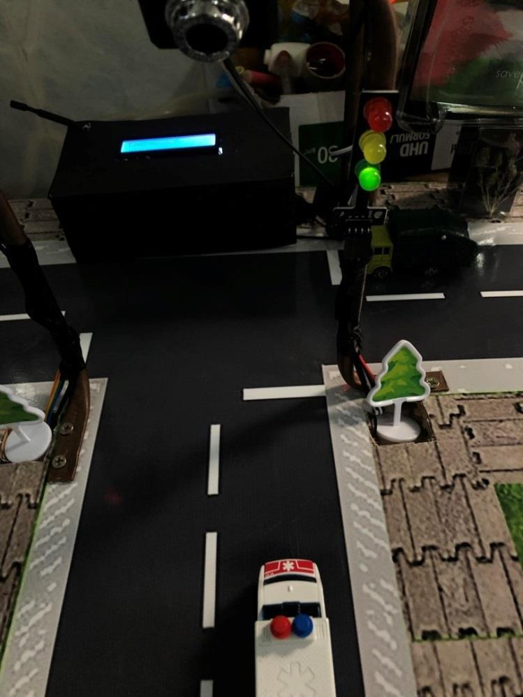
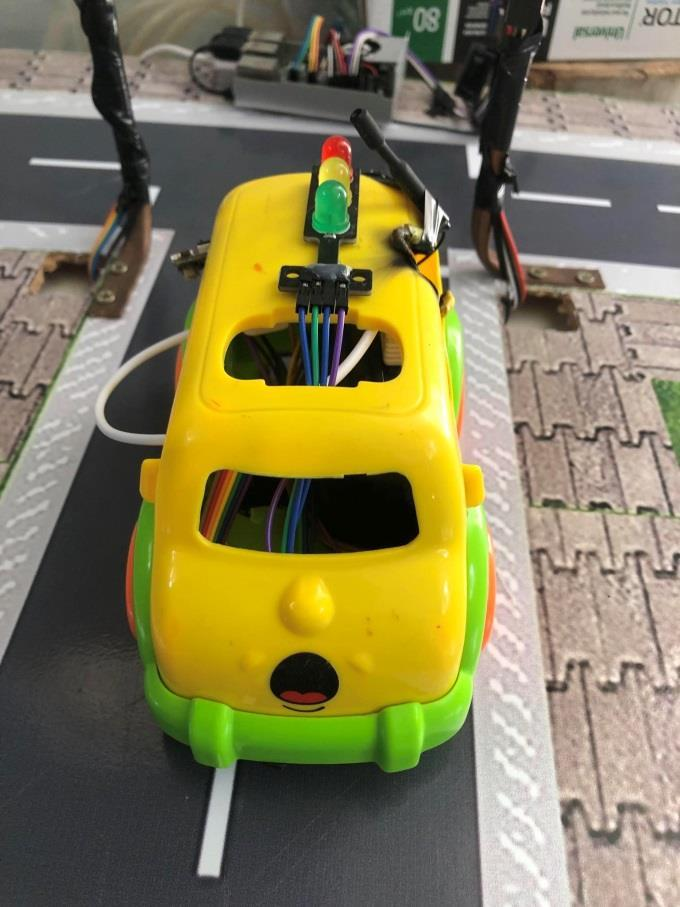
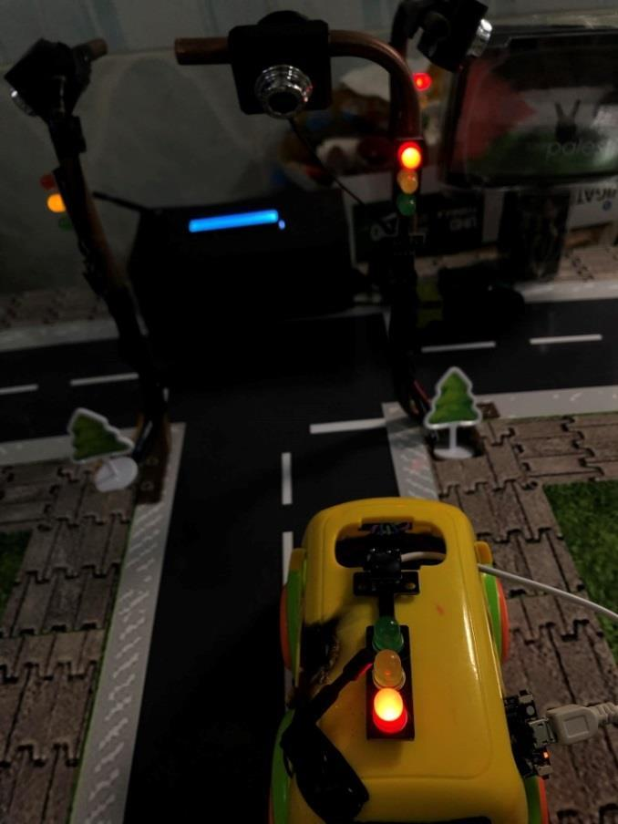

# Smart Traffic System (reconstruction)

This is a new implementation based on the 2023–24 final-year project report by Mohamed Aziz Turki and Amen Allah Bayoudh. It is not recovered source code and is not a line-for-line copy of the original. The report describes a T-junction prototype with camera-based priority-vehicle detection, traffic-light control, and a LoRa/RFID model vehicle.

**Original project report:** [rapportPFE.pdf](report.pdf)  
**Extracted prototype photos:** [gallery](assets/photos/)

## Prototype photos

These images are extracted from the original project report and show the physical demonstrator and selected tests.

| Intersection model | Emergency-vehicle test |
| --- | --- |
|  |  |

| Model vehicle and electronics | Vehicle signal test |
| --- | --- |
|  |  |

More views: [intersection with cameras](assets/photos/intersection-model-cameras.jpg), [intersection overview](assets/photos/intersection-model-overview.jpg), [vehicle electronics](assets/photos/vehicle-electronics.jpg), and [vehicle at the model intersection](assets/photos/vehicle-model-intersection.jpg).

## What is included

- A Raspberry Pi Python application for three camera feeds, YOLO detection, MQTT events, timed traffic phases, and GPIO LEDs.
- A Heltec Wireless Stick transmitter sketch that subscribes to `SMTraffic` over Wi-Fi/MQTT and forwards the signal state over LoRa.
- A Heltec Wireless Stick receiver sketch that reads LoRa, checks lane/intersection RFID tags, and controls the model-car LEDs.
- A model-training script and dataset configuration example.
- Configuration, wiring notes, protocol description, and a no-hardware controller simulation.

## Important reconstruction limits

- The report does not include the original source files, trained weights, training images, or the RFID tag UIDs. Those are not recreated here. Add your own model at `models/best.pt`, provide your dataset, and fill in the tag map in the receiver sketch.
- The report specifies Raspberry Pi GPIOs and general LoRa/RFID wiring, but does not identify the exact Wireless Stick hardware revision or every radio pin. The included sketches target Wireless Stick V1/V2 boards with the SX1276 radio and the classic Arduino `LoRa` library. Wireless Stick V3 uses SX1262 and needs a different radio driver. Confirm the label and board pinout before wiring or compiling.
- The report's performance result is a prototype measurement: detection delay reportedly fell from about 24–27 seconds to 4–8 seconds after frame skipping, reduced camera resolution, and multiprocessing. This is not suitable for controlling real road traffic.
- This project is for a tabletop demonstrator only. It has no certified fail-safe design and must never be connected to public-road signal equipment.

## Repository layout

```text
raspberry_pi/                 Python controller and camera detector
  traffic_system/             MQTT, GPIO, detector, and app modules
  scripts/                    Model training helper
  config/                     Model dataset example
heltec/                       Arduino transmitter and car receiver
docs/                         Architecture, wiring, and MQTT/LoRa payloads
models/                       Place your trained best.pt here (not included)
```

## Quick start: controller simulation

Requires Python 3.10 or newer.

```bash
cd raspberry_pi
python -m venv .venv
# Windows: .venv\Scripts\activate
# Raspberry Pi/Linux: source .venv/bin/activate
pip install -r requirements.txt
python -m traffic_system --simulate
```

The simulation logs the normal three-lane cycle and accepts console commands. Enter `priority lane1`, `priority lane2`, or `priority lane3` to simulate an emergency-vehicle event; enter `q` to stop.

## Raspberry Pi setup

See [docs/setup.md](docs/setup.md) and [docs/wiring.md](docs/wiring.md) before connecting hardware. Copy `.env.example` to `raspberry_pi/.env` and set your broker details; do not commit credentials. Install the appropriate Raspberry Pi GPIO package for your OS, configure the camera indices, set the trained model path, then run:

```bash
python -m traffic_system
```

The application defaults to dry-run GPIO output. Set `GPIO_ENABLED=true` only after checking the wiring and pin map.

## Hardware and model checklist

- Raspberry Pi 4 (4 GB as documented), three USB cameras, and the tabletop signal LEDs.
- Two compatible Heltec Wireless Stick boards, one at the intersection and one in the model vehicle.
- MFRC522 reader and lane/intersection RFID tags on the model vehicle.
- A broker reachable by the Pi and transmitter. Use a broker you control, with authentication and TLS where available.
- A trained YOLO weights file at `models/best.pt`, plus the model's actual priority class names.
- A confirmed radio band and exact board revision for both Heltec sticks.

## Acknowledgement

The design details and measured prototype limitations were reconstructed from the project report, *Système Intelligent de gestion du trafic « Smart Traffic System »*, ISET de Radès, academic year 2023/2024. The report credits both authors.

---

© reserved to MAT
